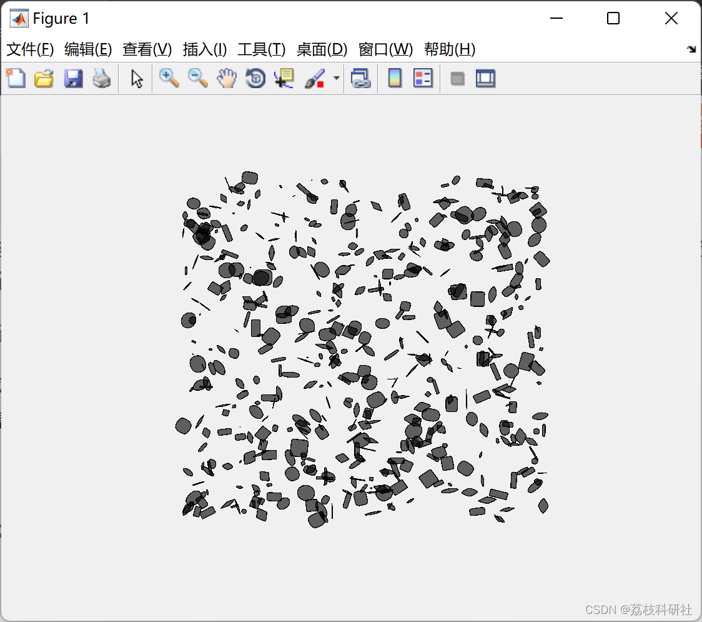
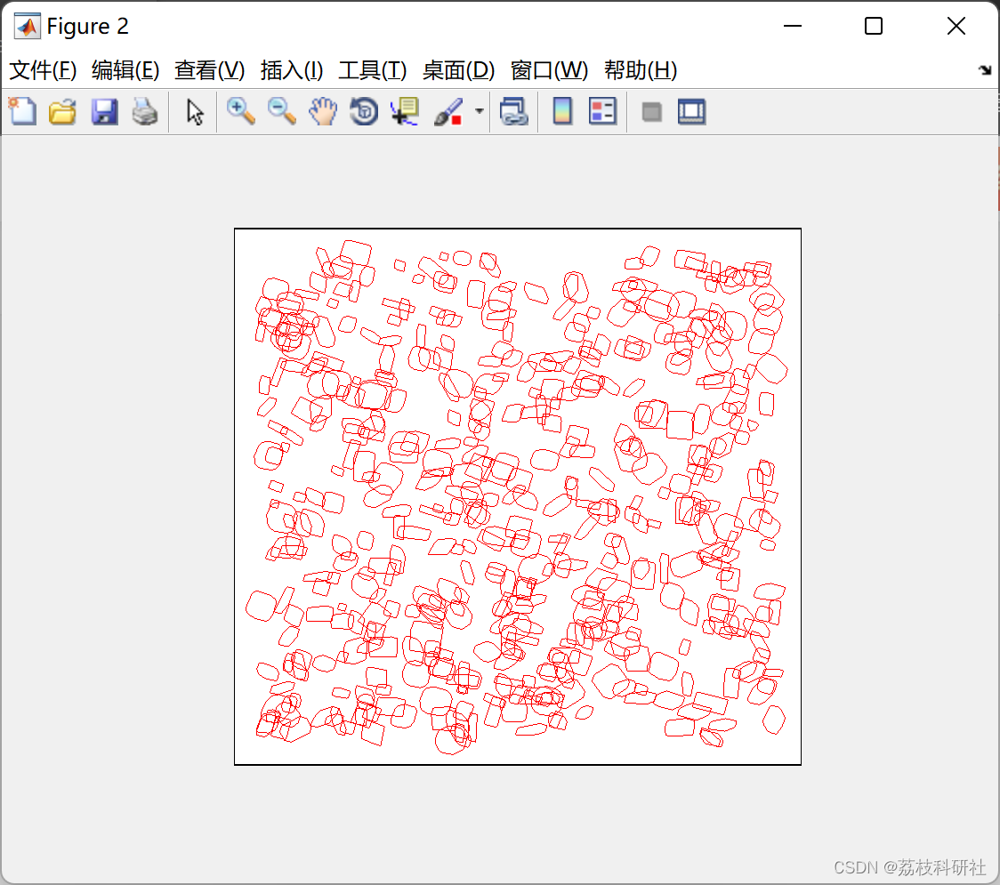
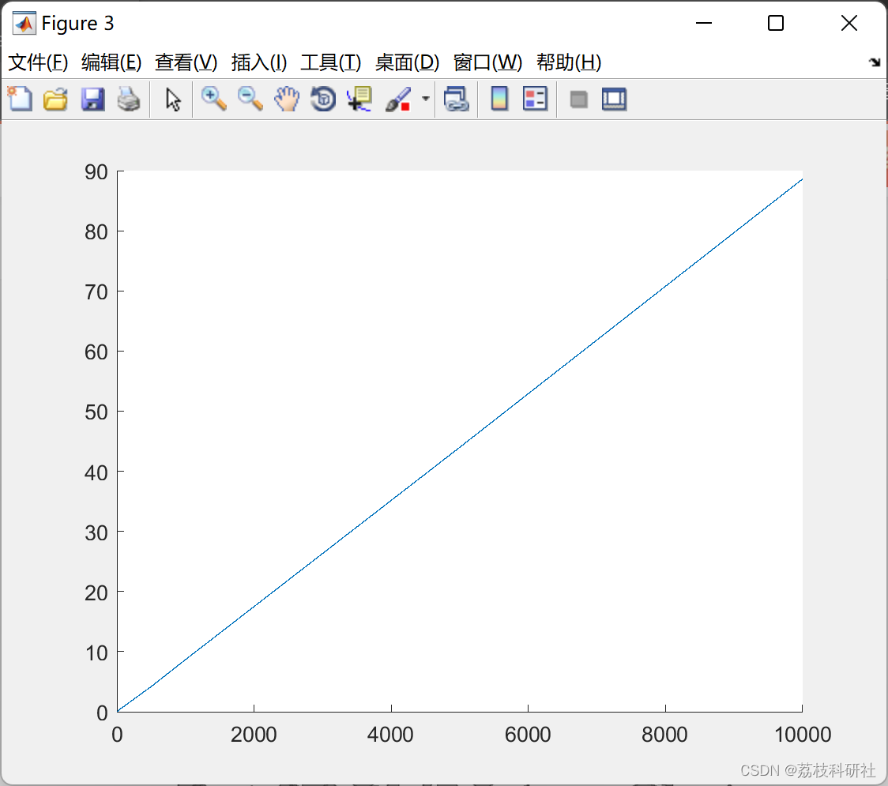
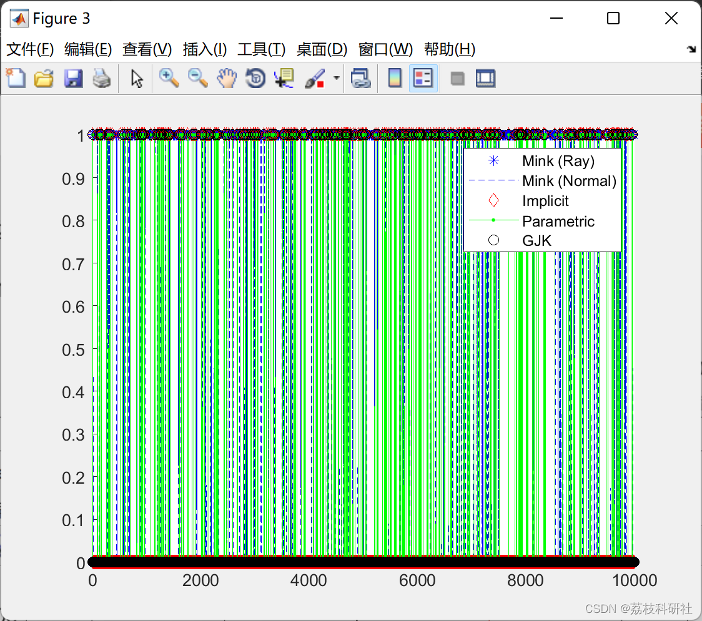
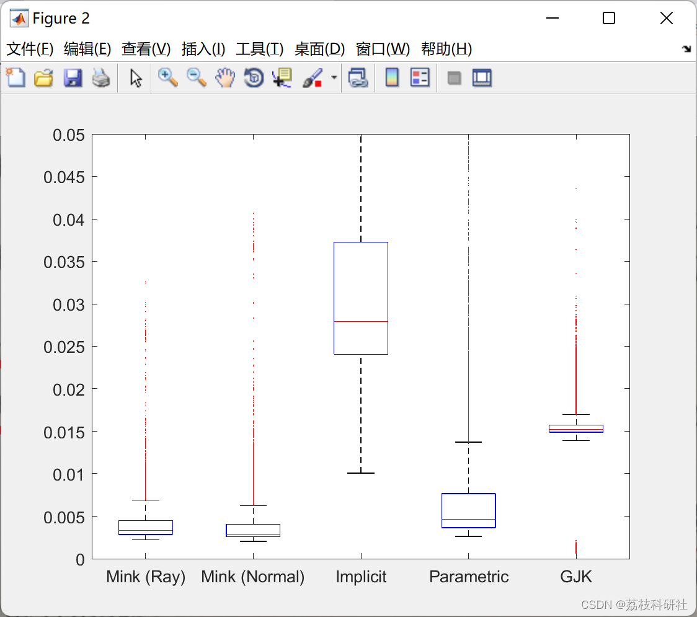

# Precise closed-form Minkowski study of general convex bodies with smooth positive curves

The main results are represented by two theorems:

Theorem 1 (Theorem 4.1 in the article): Use the unit normal vector of each surface point to directly parametrize Minkowski and. Although it is mathematically simple to express, this parametrization is not always practical for computation;

Theorem 2 (Theorem 4.3 in the article): Derive a more useful closed-form expression using unnormalized gradients.

In special cases of two ellipsoids, the suggested expression is the same as the one derived from geometric interpretation previously used. To verify the results, numerical validation and comparison between the Minkowski and of two hyperbolic bodies were conducted.

Discussion and demonstration of two applications:

Generating configuration space obstacles in motion planning problems;

Improving the performance of collision detection algorithms based on optimization.

📚2 Run Results Edit

Edit

Edit

Edit

Edit

Here are only some of the run results. Partial code:

Close all; clear; clc; 
Add_paths(); 
% Robot  
N_vtx = 50;  
robot = SuperEllipse([5*rand, 3*rand, rand, 0, 0, 0, pi*rand, N_vtx]);  
robot_config = [robot.a, robot.eps, robot.tc', robot.ang];  
% Generate environment  
N = [1,10,50,200,500,1e3,5e3,1e4];  
% N = [1,10,50,200,500];  
N_ang = 50;  
c_obs = cell(1,length(N));  
obstacle = cell(1,length(N));
obs_config = cell(1,length(N));  
run_time = zeros(1,length(N));  
%% Main routine  
disp('****************************************************************')  
disp('Application on configuration-space obstacle generations in SE(2)')  
disp('****************************************************************')  
for i = 1:length(N)  
disp(['Number of obstacles: ', num2str(N(i))])  
[obstacle{i}, obs_config{i}] = generate_obstacle(N(i));  
% Minkowski sums  
mink = cell(N(i), N_ang);  
ti = tic;  
for k = 1:N_ang  
robot_ang = (k-1)*pi/N_ang;  
for j = 1:N(i)  
minkObj = MinkSumClosedForm(robot, obstacle{i}{j},...  
rot2(robot_ang), rot2(obstacle{i}{j}.ang));  
m1 = robot.GetGradients();  
mink{j,k} = minkObj.GetMinkSumFromGradient(m1) +...  
obstacle{i}{j}.tc;  
end  
end  
run_time(i) = toc(ti);  
c_obs{i} = mink;  
end  
%% Plots  
figure; hold on; grid on; axis off;  
idx = 5;  
bd = 220;  
for i = 1:N(idx)  
% obstacles in workspace  
obstacle = SuperEllipse([obs_config{idx}(i,1:3), 0,...  
obs_config{idx}(i,4:end), N_vtx]);  
obstacle.PlotShape('k');  
end  
figure; hold on; grid on; axis off;  
for i = 1:N(idx)  
% obstacles in workspace  
obstacle = SuperEllipse([obs_config{idx}(i,1:3), 0,...  
obs_config{idx}(i,4:end), N_vtx]);  
obstacle.PlotShape('k');  
for k = 1:5:N_ang  
% c-obstacles  
robot_ang = (k-1)*pi/N_ang;  
plot3(c_obs{idx}{i,k}(1,:), c_obs{idx}{i,k}(2,:),...  
robot_ang*ones(1,50), 'r-', 'LineWidth', 0.1)  
% arena boundary  
arena = [[-bd;-bd;robot_ang], [-bd;bd;robot_ang],...  
[bd;bd;robot_ang], [bd;-bd;robot_ang]];  
patch(arena(1,:), arena(2,:), arena(3,:), 'w')  
end  
end  
xlabel('x')  
ylabel('y')  
zlabel('\theta')  
figure; hold on;  
plot(N, run_time);  
%% Subroutine for generate N random obstacles  
function [obstacle, obs_config] = generate_obstacle(N)  
obs_a = 10*rand(2,N);  
obs_eps = 2 * rand(1,N);  
obs_taper = zeros(1,N);  
obs_tx = 200 * (2*rand(2,N)-1);  
obs_th = pi * rand(1,N);  
obstacle = cell(1,N);  
for i = 1:N  
obstacle{i} = SuperEllipse([obs_a(:,i)', obs_eps(i), obs_taper(i),...  
obs_tx(1,i), obs_tx(2,i), obs_th(i), 50]);  
end  
obs_config = [obs_a; obs_eps; obs_tx; obs_th]';  
end  
🌈3 Matlab code implementation
🎉4 References
​  

## Images

<!-- PAYMENT_BLOCK -->

## Get this dataset

- Payment link (Stripe): [Buy now](https://buy.stripe.com/3cs8yP7sY87d0vu9AB)
- Payment QR code: 

<!-- /PAYMENT_BLOCK -->
